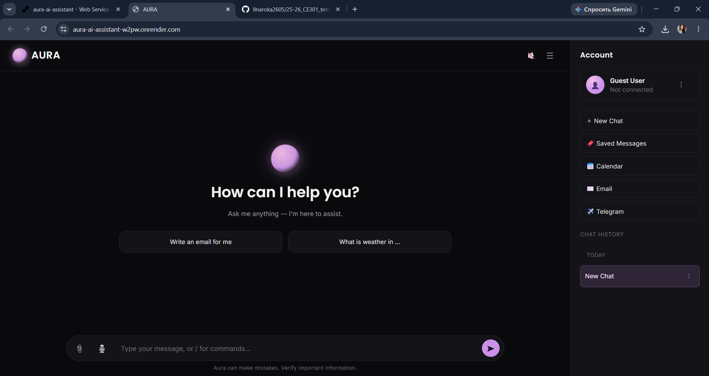
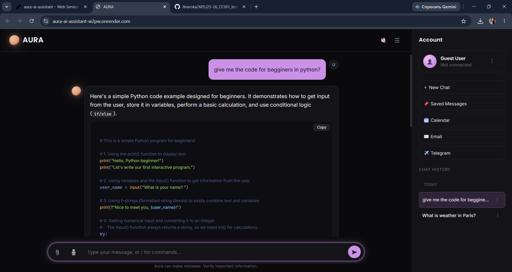

# AURA — Conversational AI Assistant

[](https://github.com/Ilnaroka2605/25-26_CE301_temerbulatova_ilnara/actions/workflows/ci.yml)

AURA is a web-based conversational AI assistant built with Python and Flask and powered by Google's Gemini API. It provides an interactive chat interface with additional features for weather and news lookups, Google sign-in, saved conversations, and a companion Telegram bot.

The project explores how a conversational AI model can be combined with external APIs and a web interface to create a practical assistant.

**[Live Demo](https://aura-ai-assistant-w2pw.onrender.com) · [Source Code](https://github.com/Ilnaroka2605/25-26_CE301_temerbulatova_ilnara) · [GitHub Actions](https://github.com/Ilnaroka2605/25-26_CE301_temerbulatova_ilnara/actions)**

---

## Screenshots

### AURA Web Interface



*The main interface of AURA, featuring the chat area and message input.*

### Conversational AI



*An example conversation showing how AURA responds to a user prompt.*

---

## Features

- **AI-powered conversations:** Generate responses using Google's Gemini 2.5 Flash model.
- **Interactive web interface:** Chat through a browser-based interface built with HTML, CSS, and JavaScript.
- **Google sign-in:** Authenticate using Google OAuth.
- **Weather lookups:** Retrieve weather information for a requested location using an external weather API.
- **News search:** Retrieve news using NewsAPI.
- **Conversation history:** Keep conversations and saved messages in the browser using `localStorage`.
- **Telegram bot:** Interact with the assistant through Telegram, using the Flask backend.
- **Automated testing:** Run project tests using pytest.
- **Continuous integration:** Use GitHub Actions to run automated checks when changes are pushed.

*Availability of individual features depends on the relevant API configuration and credentials.*

---

## Tech Stack

| Technology | Purpose |
|---|---|
| Python | Main application language |
| Flask | Backend and HTTP routes |
| Google Gemini API | AI-generated responses |
| HTML, CSS, JavaScript | Frontend interface |
| Google OAuth | User sign-in |
| Weather API | Weather information |
| NewsAPI | News retrieval |
| `localStorage` | Browser-side conversation history |
| Python Telegram Bot | Telegram integration |
| pytest | Automated testing |
| GitHub Actions | Continuous integration |
| Render | Web application hosting |

---

## How It Works

AURA connects a browser-based chat interface to a Flask backend. The backend processes incoming requests and uses the relevant service to generate a response or retrieve information.

```text
                 User
                  |
                  v
          Web Chat Interface
          HTML / CSS / JavaScript
                  |
                  v
             Flask Backend
                app.py
                  |
          +-------+--------+
          |       |        |
          v       v        v
       Gemini   Weather   NewsAPI
          |       |        |
          +-------+--------+
                  |
                  v
          Response to User


        Telegram Bot
              |
              v
         Flask Backend
```

Conversation history is stored in browser `localStorage`. The Telegram bot sends messages to the Flask backend, allowing the assistant to be accessed through a second interface.

---

## Project Structure

```text
25-26_CE301_temerbulatova_ilnara/
│
├── app.py
├── telegram_bot.py
├── requirements.txt
├── .env.example
├── README.md
│
├── templates/
│   └── index.html
│
├── static/
│   ├── css/
│   │   └── style2.css
│   └── js/
│       └── script.js
│
├── tests/
│	└── test_app.py
│
├── conftest.py
│
├── .github/
│   └── workflows/
│       └── ci.yml
│
└── docs/
    └── images/
```

The structure above highlights the main application files. Additional files and subdirectories may exist in the repository.

---

## Getting Started

Follow these steps to run AURA locally.

### Prerequisites

- Python 3.10 or a compatible version supported by the project dependencies.
- Git.
- API credentials for the services you want to use.

### 1. Clone the repository

```bash
git clone https://github.com/Ilnaroka2605/25-26_CE301_temerbulatova_ilnara.git
cd 25-26_CE301_temerbulatova_ilnara
```

### 2. Create a virtual environment

**Windows (Command Prompt):**

```bat
python -m venv venv
venv\Scripts\activate
```

**macOS / Linux:**

```bash
python3 -m venv venv
source venv/bin/activate
```

### 3. Install dependencies

```bash
python -m pip install -r requirements.txt
```

### 4. Configure environment variables

Create a local `.env` file based on `.env.example` and add the required credentials.

For example:

```dotenv
SECRET_KEY=your_generated_secret_key
GEMINI_API_KEY=your_gemini_api_key
```

Add the additional variables required by the weather, news, Google OAuth, and Telegram integrations that you intend to use.

The variable names in `.env` must match those expected by the application.

**Security:** Never commit `.env` or expose API keys, OAuth secrets, Telegram bot tokens, or production secret keys in your repository. Use environment variables in Render for the deployed application.

### 5. Run the Flask application

```bash
python app.py
```

Open the following address in your browser:

`http://127.0.0.1:5000`

### 6. Run the Telegram bot (optional)

Open a second terminal, activate the virtual environment, and configure the Telegram bot token.

With the Flask application running, start the bot:

```bash
python telegram_bot.py
```

The bot requires its own valid token and access to the Flask backend. Configure any required environment variables before starting it.

---

## Testing

AURA includes pytest tests for checking application behaviour.

Run the test suite from the project root:

```bash
python -m pytest -v
```

Tests that call external APIs should use mocks where appropriate, so they can run without depending on live API responses or consuming API credits.

The project also includes a GitHub Actions workflow for automated checks.

[View the CI workflow and results](https://github.com/Ilnaroka2605/25-26_CE301_temerbulatova_ilnara/actions/workflows/ci.yml).

---

## Deployment

AURA is deployed as a web application on Render.

**Live application:** [Open AURA](YOUR-RENDER-URL)

The deployment uses Gunicorn to serve the Flask application. Required API credentials and secret configuration are supplied through Render environment variables rather than committed to source control.

The live version depends on the availability and configuration of the external services used by the application.

---

## Design Decisions

- **Flask:** Provides a straightforward way to define backend routes and connect external services.
- **Gemini API:** Handles natural-language responses without requiring a language model to be trained from scratch.
- **Browser `localStorage`:** Keeps conversation history available in the same browser without introducing a database. This is a simple approach for a demonstration project, but it does not provide server-side persistence or automatic synchronisation across devices.
- **Separate Telegram interface:** Reuses the Flask backend so that the assistant can be accessed outside the browser.
- **Environment variables:** Keep API credentials and application secrets separate from the source code.
- **Automated testing and CI:** Help identify regressions when application code changes.

---

## Current Limitations

- **Conversation persistence:** Chat history is stored in browser `localStorage`, so it is tied to that browser and device.
- **In-memory user data:** User data held in Python memory is not persistent across server restarts and is not suitable for production account storage.
- **Weather query parsing:** City extraction relies on simple text patterns, so some natural-language requests may not be recognised.
- **External service dependencies:** Gemini, weather, news, Google OAuth, and Telegram functionality depend on their respective APIs, credentials, and service availability.
- **Production hardening:** Further work could improve rate limiting, monitoring, persistent storage, and error handling.

---

## Future Improvements

- Add a database such as SQLite or PostgreSQL for persistent conversation and user data.
- Improve input validation and error handling.
- Add rate limiting and structured logging.
- Expand automated tests for backend routes and external API integrations.
- Improve weather and news query interpretation.
- Add more deployment monitoring and security checks.

---

## Author

**Ilnara Temerbulatova**

GitHub: [@Ilnaroka2605](https://github.com/Ilnaroka2605)

---

*Developed as a university software project to explore conversational AI, backend development, API integration, and web application deployment.*